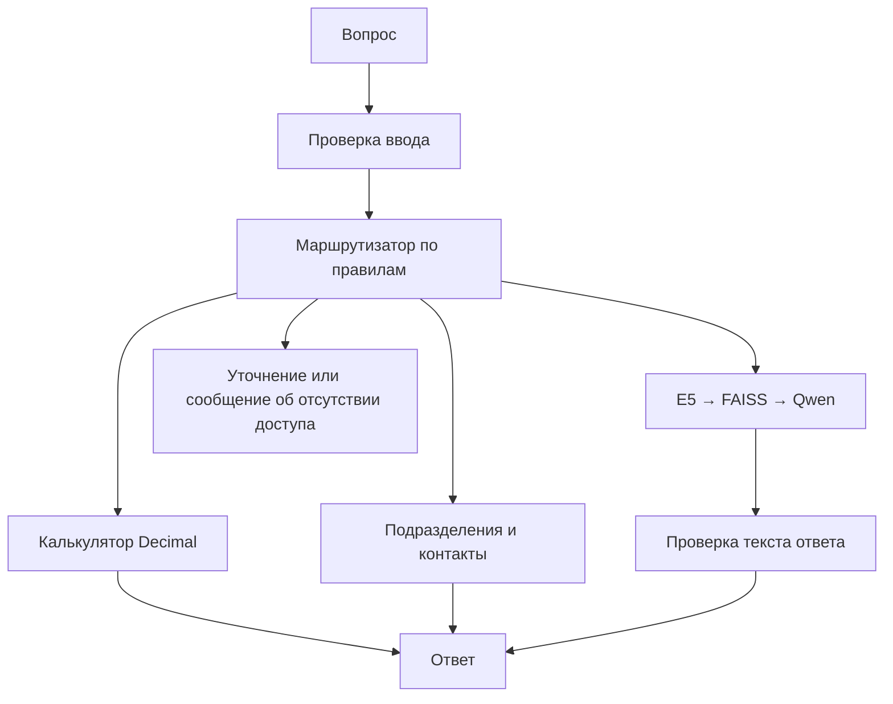

# Нужен ли ассистенту агент

Дата проверки: 02.11.2026. Проект относится только к МГТУ им. Г. И. Носова.

## Решение

Автономный агент для текущих задач не нужен. Оставляем RAG и добавляем четыре инструмента с фиксированным выбором в программе. LLM отвечает на вопросы по документам, но не выбирает функции и не строит цепочки действий.

Нужные операции короткие: получить контакт, найти ответственное подразделение, посчитать выражение или прочитать правила. Они не требуют самостоятельного плана. У проекта нет подключения к расписанию групп, личным кабинетам и закрытым базам. Агент не сделает эти данные доступными.

Мы реализовали и сравнили **A: обычный RAG** и **B: RAG с инструментами**. Автономного LLM-агента не реализовывали и не измеряли. Результаты показывают пользу отдельных инструментов; они не доказывают преимущество над всеми возможными агентами.

## Как работает B

`calculate(expression)` допускает числа, скобки и четыре арифметических действия. `find_department(department_id)` возвращает подразделение. `get_contact_information(department_id)` возвращает публичные контакты. `search_knowledge_base(question)` запускает RAG. За один запрос разрешён один вызов; результат LLM не превращается в новую команду.

Справочник содержит 25 подразделений. Каждое поле взято из сохранённого официального текста, с позициями и контрольной суммой. Это снимок, а не онлайн-проверка контактов. При неоднозначном названии нужен уточняющий вопрос. Если шаблон запроса не распознан, используется RAG.

Для A сохранена конфигурация третьей лабораторной: 384 токена, top-k=2, grounded. В B те же индекс и модели: **intfloat/multilingual-e5-small**, ONNX float32, ревизия `614241f622f53c4eeff9890bdc4f31cfecc418b3`; **Qwen2.5-1.5B-Instruct Q4_K_M**, ревизия `91cad51170dc346986eccefdc2dd33a9da36ead9`; **llama.cpp b12032**, commit `dde879bc4`. Обе модели работают на CPU. Точные файлы и SHA-256: [assets.json](../config/assets.json).

## Эксперимент

Подготовлены 28 вопросов шести групп. Каждый задан обоим вариантам три раза: всего 168 запросов. Порядок A/B чередовался. Параметры и файлы зафиксированы до первого ответа; по этим результатам маршрутизатор не перенастраивался. Сохранились [протокол](../data/evaluation/ab_protocol.json), [вопросы](../data/evaluation/ab_cases.jsonl) и [все ответы](../experiments/results/comparison_responses.jsonl).

Проверка ищет заданные факты или точный результат вычисления и учитывает обрыв ответа. Для каждого вопроса берётся большинство из трёх повторов. Это **автоматическая проверка по шаблонам, а не экспертная точность**. Источники и выбор маршрута проверяются отдельно. Три повтора не считаются тремя независимыми вопросами.

| Задачи | Вопросов | A: проверка пройдена | B: проверка пройдена | Медиана A, с | Медиана B, с |
|---|---:|---:|---:|---:|---:|
| Контакты | 6 | 4 | 6 | 8.0826 | 0.0009 |
| Подразделения | 4 | 2 | 4 | 7.0651 | 0.0006 |
| Расчёты | 6 | 2 | 6 | 6.3882 | 0.0003 |
| Положения и инструкции | 6 | 3 | 3 | 7.9247 | 8.4638 |
| Границы доступа | 2 | 2 | 2 | 3.5492 | 0.0002 |
| Сложные формулировки | 4 | 1 | 1 | 7.5022 | 7.7637 |

Всего проверку прошли **14/28 у A и 22/28 у B**. Шаблоны могут отвергать полезный ответ: например, в D01 вариант A назвал правильную аудиторию 226, но не название отдела, которое требовала проверка. Поэтому разницу нельзя целиком объявлять ростом точности. Вопросы составлены с помощью ИИ по этому корпусу, независимой проверки другой командой нет.

## Что стало лучше и хуже

Расчёты: B прошёл 6 из 6, A — 2 из 6. Контакты: B прошёл 6 из 6, A — 4 из 6. Для таких запросов B возвращает проверенное поле или результат вычисления без генерации. Это главный довод за инструменты.

В вопросах по положениям оба варианта прошли 3 из 6. Инструменты не исправляют пропуски поиска и неполные ответы Qwen. Например, оба варианта не ответили на R01 о договоре практики. Пересказывать положение через калькулятор или справочник бессмысленно.

Общая медиана времени: A — 7.371 с, B — 0.0008 с. Это время запроса в уже загруженном процессе. Загрузка моделей и прогрев заняли 4.37 с и в эту медиану не входят. Большинство запросов B обходятся без LLM: генераций 27 против 84 у A.

На длинных запросах выигрыш исчезает: p95 — 9.709 с у A и 10.041 с у B. Для положений медиана B — 8.464 с против 7.925 с у A. Дополнительная инструкция и проверки немного замедляют RAG.

Появились ограничения маршрутизации. В H01 B просит разделить поиск телефона и расчёт на два вопроса. Формулировку «как связаться с выпускным отделом» в H02 он не распознал как запрос к справочнику и передал RAG; ответ содержит неверные контакты. В H03 арифметика словами также ушла в RAG, хотя численный ответ оказался правильным. В H04 оба варианта начали верный ответ, но он оборвался на лимите 128 токенов. Эти примеры приведены в [сверке ответов](answer_examples.md).

## Сложность и ресурсы

К исходным 12 Python-файлам в `src/` добавлено 8. Число непустых строк без строк-комментариев выросло с 253 до 464. Это простая оценка объёма, не мера качества. Теперь нужно поддерживать правила маршрутизации, справочник, схемы аргументов и проверки безопасности. Появились 17 автоматических тестов. [Подсчёт](../experiments/results/complexity.json).

Ориентир памяти процессов: **8 ГиБ предпочтительно, 16 ГиБ допустимо**. На Windows выполнены два отдельных прогона B по 12 вопросам:

| Лимит commit | Запросов B | Результат | Пик commit, ГиБ | Пик RSS, ГиБ |
|---|---:|---|---:|---:|
| 8 ГиБ | 12 | passed | 3.505 | 2.692 |
| 16 ГиБ | 12 | passed | 3.505 | 2.692 |

Это ограничения commit всего дерева процессов через Windows Job Object; RSS измерялся отдельно. У компьютера физически 32 ГБ ОЗУ. Работа всей Windows с физическими 8 ГБ не проверялась; для машины рекомендуется 16 ГБ с запасом для ОС. Индексы в этих прогонах загружались готовыми: их данные не менялись с третьей лабораторной. [Результаты](../experiments/results/memory_limits.json).

## Итог выбора

Используем B как ограниченный справочный помощник. Выигрыш получен от точного справочника и калькулятора. Свободное планирование LLM пока не решает дополнительной задачи, зато потребует новых прав и проверок. Возвращаться к агенту стоит, когда появится конкретный сценарий из нескольких действий и проверенный источник нужных данных. Остаточные проблемы безопасности описаны [отдельно](security_tests.md).
